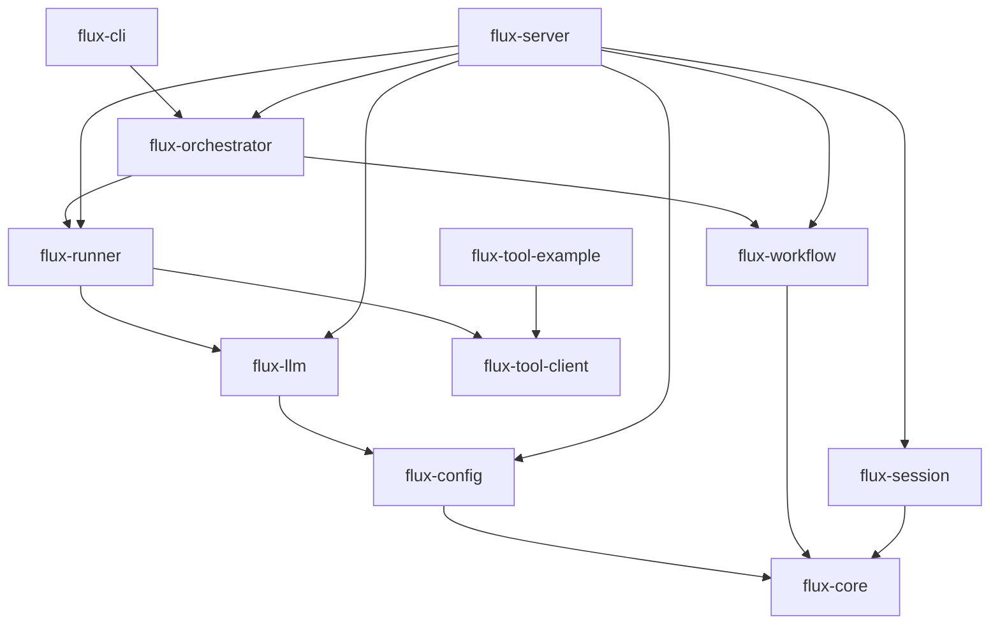

# Flux AI

Flux AI is a platform for defining AI agents as YAML and orchestrating them into workflows. It talks to LLMs through its own provider layer (`flux-llm`) and provides event-sourced sessions, SSE streaming, and durable human-approval gates.

## Quickstart (Docker)

No Rust toolchain needed, and no API key: the bundled `mock-chat` workflow uses the mock provider.

```bash
docker compose up -d --build    # --build can be dropped once a published image exists
curl -s localhost:8080/workflows
```

Start a run, then stream its events (replace `<run_id>` with the id the first call returns):

```bash
curl -s localhost:8080/runs -H 'content-type: application/json' \
  -d '{"workflow_id":"mock-chat","input":"hello mock"}'
# {"run_id":"<run_id>"}
curl -N localhost:8080/runs/<run_id>/events
# ... data: "WorkflowComplete"
```

Or run a workflow to completion in one call with `POST /chat`:

```bash
curl -s localhost:8080/chat -H 'content-type: application/json' \
  -d '{"workflow_id":"mock-chat","input":"hello mock"}'
# {"reply":"hello mock","run_id":"...","status":"complete","structured":null}
```

`agents/` and `workflows/` are mounted read-only into the container, so edit them
locally and run `docker compose restart flux`. Port 8080 taken? Set `FLUX_PORT`
(for example `FLUX_PORT=9090 docker compose up -d --build`). Stop with `docker compose down`.
The port is published on `127.0.0.1` only: Flux has no built-in authentication (see [SECURITY.md](SECURITY.md)) and the container may hold your API keys.

To use a real model, export `ANTHROPIC_API_KEY` (or `OPENAI_API_KEY`), point an
agent at `provider: anthropic` (or `openai`), and run `docker compose up -d` again.
Compose passes the keys through from your shell; they are never stored in a file.

For persistent conversation memory, add Postgres with the override file:

```bash
docker compose -f docker-compose.yml -f docker-compose.memory.yml up -d
```

It starts a Postgres container and sets `DATABASE_URL` for Flux (trust auth, for local use only).

### Install a prebuilt binary

Every `v*` tag publishes `flux-server`, `run_agent` and `run_workflow` for Linux
and macOS (x86_64 and aarch64), with `.sha256` checksums, on the
[GitHub Releases page](https://github.com/thinkbytelabs/flux-ai/releases), and a
multi-arch container image at `ghcr.io/thinkbytelabs/flux`.

The tarball includes `config/`, `agents/` and `workflows/`. Run from the extracted
directory (or set `FLUX_CONFIG_DIR`), pass the directories, and make sure Redis is
reachable (`REDIS_URL`, default `redis://127.0.0.1:6379`):

```bash
./flux-server --agents-dir agents --workflows-dir workflows
```

## Quickstart (from source)

The bundled `echo` agent calls a real LLM, so it needs an Anthropic or OpenAI API key (the `echo` agent uses Anthropic). To run with no key at all, use the mock provider (see "Try it with no API key" below).

```bash
export ANTHROPIC_API_KEY=sk-ant-...
cargo run --bin run_agent -- agents/echo.yaml "hello world"
```

This runs a single agent that rephrases your message in exactly five words, streaming events to stdout.

> `NoopTransport` stubs out *tools*, not the model — the model call goes to a real provider unless the agent uses `provider: mock`.

## Try it with no API key

The `mock` provider emits scripted output with no network call and no API key —
ideal for local dev, demos, and CI. The bundled `mock` agent echoes your input:

```bash
# No API key needed. Streams the echoed input over SSE.
cargo run --bin flux-server -- --agents-dir agents --workflows-dir workflows &
curl 127.0.0.1:8080/runs -H 'content-type: application/json' \
  -d '{"workflow_id":"mock-chat","input":"hello mock"}'
# read the run's events at GET /runs/{run_id}/events
```

`flux-server` needs a local Redis for run state (`docker run -d -p 6379:6379 redis`
or `brew services start redis`). Without one it fails at boot within 5 seconds
naming the URL it tried. The CLI binaries (`run_agent`, `run_workflow`) need
Redis only when conversation memory is configured.

For deterministic tests, set a canned reply on the agent's `model:` block —
`mock_response: "..."`. If the agent also declares an `output_schema` and the
`mock_response` is JSON, it is parsed into the structured output, so a mock
workflow can drive `when`/`depends_on` branches without any provider.

## Architecture

Flux is a Cargo workspace of 11 crates with strictly downward, acyclic dependencies. `flux-core` defines the shared domain types and error type; everything builds up from there. The CLI bins and the HTTP server are the only `anyhow` edges — libraries use `thiserror`/`FluxError`.



ASCII fallback:

```
flux-core ← flux-config ← flux-llm ← flux-runner ← flux-orchestrator ← flux-cli
flux-workflow → flux-core
flux-session  → flux-core
flux-server   → flux-orchestrator, flux-session, flux-workflow, flux-config, flux-llm, flux-runner
flux-tool-client used by flux-runner; flux-tool-example is a standalone example tool server
```

Tool calls route through `ToolTransport`, a trait with two peer implementations
in `flux-tool-client`: `GrpcTransport` talks to external gRPC tool servers,
`McpTransport` spawns and talks to MCP servers over stdio. `AnyTransport` is a
closed enum holding whichever kind a given backend turned out to be — closed
because these are the only two transports this crate ships, not a plugin
point. `MultiTransport<AnyTransport>` fans a stage's tool name out across every
configured backend, gRPC and MCP alike, building one name-routed table at
boot; a workflow stage only ever says `tool: <name>` and never learns which
kind answered it.

## Crates

| Crate | Responsibility |
|-------|----------------|
| `flux-core` | Shared domain types, events, and the `FluxError` error type. |
| `flux-config` | Loads and validates agent and registry YAML. |
| `flux-llm` | LLM provider layer: Anthropic, OpenAI-compatible and mock backends behind `LlmBackend`, selected by name through `LlmRegistry` (configured from `llm.providers`). |
| `flux-runner` | Runs a single agent: prompt rendering, LLM call, tool loop, structured output. |
| `flux-tool-client` | Tool-server client: `GrpcTransport` and `McpTransport` as peer `ToolTransport` impls, unified by `AnyTransport`/`MultiTransport`. |
| `flux-tool-example` | Standalone example gRPC tool server (canned weather). |
| `flux-workflow` | Workflow DAG model and YAML loading (`Stage`, `when`, approval flags). |
| `flux-orchestrator` | Executes workflows: ready-rounds, conditional skip-cascade, parallel stages, pause/resume. |
| `flux-session` | Event-sourced sessions and the `EventStore` (`MemoryStore`, `RedisStore`). |
| `flux-server` | Axum HTTP server: run submission, SSE event streaming, approvals. |
| `flux-cli` | The `run_agent` and `run_workflow` binaries. |

## Capabilities

- **Single YAML agents** — persona, model profile, guardrails, and context defined in one file.
- **Tools over gRPC** — agents call external tools over gRPC, on both Anthropic and OpenAI-compatible providers.
- **Structured output** — schema-validated JSON responses from agents.
- **Workflow DAG** — multi-agent workflows with conditional branching (ready-rounds, `when`/skip-cascade, parallel stages).
- **Sessions & streaming** — event-sourced runs with Redis hot-state and Server-Sent Events (replay, tail, close).
- **Approval gates** — stages can require human approval; runs pause durably and resume from the event log plus a Redis manifest.
- **Tool stages** — a stage can invoke a tool directly instead of an agent, so a deterministic step costs no LLM round-trip. Downstream stages read `{{ stage.structured }}` without knowing which kind produced it.

## Known gaps

Honest list of what Flux does not do yet.

- **`flux-server` has no authentication.** Anyone who can reach the port can
  start runs, approve gates and read run events. Put it behind an
  authenticating proxy; see [SECURITY.md](SECURITY.md).

- **Tools must run out-of-process, as a gRPC or MCP server.** There is no in-process tool, so exposing a single function still means running something Flux can call into. `ToolTransport` is a trait, so further transports are additive.
- **No dynamic fan-out or sub-workflows.** The stage list is fixed at load time — no `for_each` over a runtime-sized list, and a stage cannot invoke another workflow.
- **`POST /chat` returns the workflow's `output` stage.** Set `output: <stage_id>` on the workflow to name the stage whose result is the answer; if that stage did not complete (e.g. skipped by `when`), or `output` is unset, the reply is the last completed stage, which is timing-dependent when several terminal stages run in parallel. Compose a multi-part response from the event stream when you need more than one stage.
- **Flux owns conversation memory.** There is no way to pass history in per request; state lives in Flux's own store keyed by `(conversation_id, agent_id)`.
- **A partial memory write is loud, not prevented.** If appending one exchange fails midway the log is left uneven; recall trims to a valid window and the failure is logged, but the append is not atomic.
- **The Redis memory backend is not covered by CI.** Its tests require a live server (`cargo test -p flux-memory -- --ignored`). The Postgres backend is covered the same way.
- **MCP transport is stdio only.** Network (Streamable HTTP) MCP servers are not
  supported yet.
- **MCP servers inherit the Flux process environment**, so a server sees every
  secret Flux holds. Tool credential scoping is not implemented for either
  transport.
- **The tool manifest is read once at boot.** A newly published tool requires a
  restart.
- **A dead MCP server is not restarted.** Restarting it could expose a tool list
  that disagrees with the routing table fixed at boot, so it fails loudly
  instead; this is unblocked by manifest refresh.
- **Child cleanup is not a guaranteed kill.** rmcp kills the child via a spawned
  task, which the runtime may drop before it is polled on process exit, and
  neither binary has graceful shutdown. In practice, dropping the transport
  closes the child's stdin, and MCP servers are specified to exit on stdin
  EOF — so the real guarantee is "stdin EOF, with a best-effort kill on top";
  a server that ignores stdin EOF will linger.
- **Schemas must be self-contained; an external `$ref` is refused, not fetched.**
  Flux validates arguments against the tool's JSON Schema before every call. A
  `$ref` pointing inside the same document resolves normally, but one pointing at
  an `http`/`https` URL or a `file:` path fails validation with a clear error
  rather than causing a blocking network request or a local file read. This is
  deliberate: an MCP server supplies its own tool schemas, so that document is
  not under Flux's control, and resolving it would put unbounded blocking I/O on
  the tool-call path. Enforced by a custom retriever in `flux-core::schema`, so
  it holds regardless of which `jsonschema` cargo features end up enabled in the
  dependency graph.
- **The per-call `context` value is not delivered to MCP tools** — MCP has no
  field for it. Flux logs a warning and drops it.
- **MCP result shape differs from gRPC result shape.** A workflow author must
  know which kind of tool a stage calls in order to read its output.
- **Tools only.** MCP prompts, resources, sampling, and roots are out of scope:
  Flux's model is agents, tools, and workflows.
- **Not suitable for multi-tenant deployment.** An MCP server is third-party code
  running inside the orchestrator's trust boundary.

## Binaries

Configuration loads from `$FLUX_CONFIG_DIR` (default `./config`): `base.yaml`
(required) deep-merged with `$FLUX_ENV.yaml` (default env `dev`; the overlay
file is optional). The active dir and env are logged at startup.

### `run_agent`
Run one agent against a message.
```
run_agent [--conversation-id ID] <agent.yaml> <message>
```

### `run_workflow`
Run a workflow over a directory of agents.
```
run_workflow --agents-dir <dir> [--conversation-id ID] [--context-json JSON] <workflow.yaml> <input>
```
Tool endpoints, Redis, and Postgres are config-only, not CLI flags — set
`tools.endpoint`/`tools.endpoints`/`tools.mcp`, `redis.url`, and `database.url`
in `config/*.yaml`, or override with the `REDIS_URL`/`DATABASE_URL` env vars
(see "Several tool servers" and "MCP tool servers" below, and `config/base.yaml`).
With `--conversation-id`, stages marked `remember: true` load and persist
per-agent conversation history (see "Single-agent chat" below).

### Tool stages

A stage can call a gRPC tool directly instead of an agent — no LLM round-trip,
args fixed by the YAML:

```yaml
- id: execute
  tool: safe_exec
  args:
    sql: "{{ compile.structured.sql }}"
    database: "{{ ctx.database }}"
  depends_on: [compile]
```

An `args` leaf that is exactly `{{ expr }}` (nothing else in the string)
passes the expression's native JSON value through — an object or number
stays an object or number rather than being stringified. The tool's result
is available to downstream stages as `{{ execute.structured }}`, same as an
agent stage's output. `requires_approval` works on a tool stage exactly as
on an agent stage: the gate is decided before dispatch either way.

`on_error` defaults to `abort`, which fails the whole run — the pre-existing
behavior. Set it to `continue` to instead complete the stage with the error
as its structured output, letting a following stage branch on it. This is
how bounded retry is expressed: as an extra stage, not a loop construct.

`continue` covers runtime failures only — a tool call that errors, an agent
call that fails, an LLM response that fails its `output_schema` check. A
tool stage's `args` failing the tool's JSON schema, or naming a tool that
doesn't exist, is a static defect in the workflow YAML itself, not something
a downstream stage can repair — those always abort the run regardless of
`on_error`.

```yaml
- id: execute
  tool: safe_exec
  args: { sql: "{{ compile.structured.sql }}" }
  on_error: continue

- id: repair
  agent: sql_fixer
  depends_on: [execute]
  when: "execute.structured.error is defined"
  input: "Failed: {{ compile.structured.sql }}\nError: {{ execute.structured.error }}"
```

`on_error` applies to agent stages too, not just tool stages.

A `continue`d stage's output is replaced wholesale by `{ error: … }`, so its
normal fields are gone. A downstream `when` that reads one of them is therefore
**false**, not an error — `when: "execute.structured.status == 'ok'"` skips its
stage rather than aborting the run. Everywhere else `when` stays strict: a
misspelled stage id, or a missing field on a stage that *succeeded*, still fails
the run loudly rather than silently skipping.

### Rejoining branches — `join`

A stage is skipped when any of its `depends_on` was skipped. To merge branches
that `when` makes mutually exclusive, set `join: any`: the stage then waits for
every dependency to finish, and is skipped only if *all* of them were skipped.

```yaml
- id: refund
  agent: refunds
  when: "classify.structured.kind == 'refund'"
  depends_on: [classify]
- id: answer
  agent: support
  when: "classify.structured.kind != 'refund'"
  depends_on: [classify]
- id: reply
  agent: writer
  depends_on: [refund, answer]
  join: any
  input: "{{ refund.message if refund is defined else answer.message }}"
```

A skipped dependency has no entry in the template context, so under
`join: any` read it with `is defined` or the `default` filter. A dependency
that failed under `on_error: continue` counts as having run.

### MCP tool servers

Flux can also call tools on [Model Context Protocol](https://modelcontextprotocol.io)
servers. Flux launches the server as a child process and talks MCP over its
stdin/stdout, so there is nothing to deploy:

```yaml
tools:
  mcp:
    - command: npx
      args: ["-y", "@modelcontextprotocol/server-github"]
```

Its tools join the same name-routed table as any gRPC tool server, so a stage
calls one exactly like the other:

```yaml
stages:
  - id: file_bug
    tool: create_issue
    args:
      title: "{{ workflow.input }}"
```

A tool name exported by two backends is a startup error, not a silent shadow —
whether the clash is gRPC vs. gRPC, MCP vs. MCP, or one of each. A failing MCP
tool (`isError`) surfaces as an ordinary stage failure, absorbable by
`on_error: continue` exactly like a failing gRPC call.

**Why stdio, and not network MCP.** Most self-hostable MCP servers ship as a
command to run, not a URL to call, and stdio is the only flavor of MCP that
removes the deploy step — which is the whole point of pointing Flux at one
instead of writing a gRPC tool server. Network (Streamable HTTP) MCP is the
better long-term fit for a server-side engine like Flux — no child process,
no shared filesystem with the host — and is a known follow-up (see Known
gaps).

**Mixing gRPC and MCP.** Both are `ToolTransport` peers routed by tool name
into one table, so a single workflow can call both in the same run:

```yaml
# config/base.yaml
tools:
  endpoint: "http://127.0.0.1:50051"   # flux-tool-example, serves get_weather
  mcp:
    - command: npx
      args: ["-y", "@modelcontextprotocol/server-github"]
```

```yaml
# workflows/mixed-tools.yaml
workflow_id: mixed-tools
stages:
  - id: forecast
    tool: get_weather
    args:
      location: "{{ workflow.input }}"

  - id: file_bug
    tool: create_issue
    depends_on: [forecast]
    when: "forecast.structured.conditions == 'Severe'"
    args:
      title: "Storm alert for {{ forecast.structured.location }}"
```

(The canned `flux-tool-example` server above always returns `Partly cloudy`,
so `file_bug` is always skipped if you run this verbatim — the example is
here to show the syntax for mixing transports, not to file a real issue.)

**Result shape differs by transport, and a workflow author must know which
kind of tool a stage calls in order to read its output.** A gRPC tool's
result is whatever JSON the server returns — above, `forecast.structured` is
`{ location, temperature_f, conditions }` directly, matching
`flux-tool-example`'s response. An MCP tool's result is always an object with
three fixed keys instead:

| Key | Contents |
|---|---|
| `text` | text blocks joined by newlines — the common case |
| `structured_content` | the server's `structuredContent`, or `null` |
| `content` | raw MCP content blocks, for images and embedded resources |

So `file_bug.structured` (the GitHub MCP server's `create_issue` result) is
`{ text, structured_content, content }`, not the issue fields directly:

```yaml
{{ file_bug.structured.text }}
{{ file_bug.structured.structured_content.number }}
```

`structured` is the full result above. `message` is the same stage rendered for
a reader — for an MCP tool it drops `content`, naming any non-text blocks
instead of carrying their bytes, so templating `{{ file_bug.message }}` into a
downstream agent's prompt does not ship a base64 image through the model. Reach
for `structured.content` when you actually want those blocks. For a gRPC tool,
which has no such projection, `message` is the whole result serialized.

### `flux-server`
Serve runs over HTTP with sessions, streaming, and approvals.
```
flux-server --agents-dir <dir> --workflows-dir <dir>
```
Redis, Postgres, and tool endpoints are config-only (see `config/base.yaml`):
set `database.url` to enable conversation memory, which then accepts a
`conversation_id` per run (see "Single-agent chat"); without it, runs are
stateless. Set `tools.endpoint`/`tools.endpoints` to point a run's tool calls
at external gRPC tool server(s), and/or `tools.mcp` to launch MCP servers (see
"MCP tool servers" above); leave all of them empty to stub tools with
`NoopTransport`.
Default listen address is `0.0.0.0:8080`. HTTP surface:

| Method | Path | Purpose |
|--------|------|---------|
| `POST` | `/runs` | Submit a workflow run (async): 202 with a `run_id`. |
| `POST` | `/chat` | Run a workflow to completion synchronously; the response carries `status` plus `reply` (and `structured`) once terminal. |
| `GET`  | `/runs/{run_id}` | Poll a run's status; adds `reply`/`structured` or `error` once the run is terminal. |
| `GET`  | `/runs/{run_id}/events` | Stream run events (SSE): replay, tail, close. |
| `POST` | `/runs/{run_id}/approve` | Approve a paused gate to resume the run. |
| `POST` | `/runs/{run_id}/cancel` | Stop a run. `202` accepted, `404` unknown, `409` already finished. |
| `GET`  | `/workflows` | List the workflow ids a client may pass as `workflow_id`. |

Every error response is JSON `{"error": "..."}`. `POST /runs/{run_id}/approve`
returns `410 Gone` when a paused run's Redis state (events and/or manifest)
expired before it was approved — the run is then marked failed rather than
resumed, since resuming would silently re-execute completed stages.

`POST /runs` and `POST /chat` accept an optional `Idempotency-Key` header
(1–255 characters). A retry with the same key and the same JSON body starts
nothing new: `/runs` answers `200` with the original `run_id`, and `/chat`
waits for the original run and returns its reply. The same key with a
different body is `422`. Keys are scoped per endpoint and expire
`redis.ttl_secs` after the first request; a retry after that starts a new
run, even if the original is still paused at an approval gate.

`POST /runs/{run_id}/cancel` stops a paused run at once (status `cancelled`).
A running run first shows `cancelling`, then stops within about a second —
whichever server instance runs it — abandoning its in-flight LLM and tool
calls, and ends `cancelled` with a `WorkflowCancelled` event. A tool call
already received by its server may still complete there; Flux only stops
waiting for it. A run that finishes before it notices the cancel keeps its
`complete`/`failed` status.

A standalone example tool server lives in the `flux-tool-example` crate, whose bin target is named `tool_server`:

```bash
cargo run -p flux-tool-example --bin tool_server
```

Point `run_agent`/`run_workflow`/`flux-server` at it by setting `tools.endpoint` (or `tools.endpoints`) in config.

Several tool servers can be configured at once in `config/base.yaml`, routed by tool name:
```yaml
tools:
  endpoint: ""
  # Several tool servers, routed by tool name. Wins over `endpoint` when set.
  # endpoints:
  #   - "http://query:50051"
  #   - "http://remediation:50051"
```

## LLM providers

An agent's `model.provider` names a provider. `anthropic` and `openai` are
built in (keys from `ANTHROPIC_API_KEY` / `OPENAI_API_KEY`) and `mock` needs
nothing. Add more under `llm.providers` in the settings file; any server that
speaks the OpenAI Chat Completions API works through `kind: openai_compatible`
with a `base_url`:

```yaml
# config/base.yaml
llm:
  providers:
    ollama:
      kind: openai_compatible
      base_url: "http://localhost:11434/v1"
      # api_key_env: OLLAMA_API_KEY   # optional; names an env var, never the key
```

With no `api_key_env` the provider sends no `Authorization` header, which is
what local servers expect. A provider that names an `api_key_env` requires it:
requests fail with "<VAR> is not set" while it is unset. The server and
`run_workflow` refuse to start if a loaded agent names a provider that is not
configured. A missing API key is only a warning at server boot, while an
unknown provider name stops boot. Library users can implement `LlmBackend` and
`LlmRegistry::register` their own.

## Refining a stage's answer

A stage runs its agent once. To judge an answer and retry when it is weak (the
evaluator-optimizer pattern), add a `refine` block to an agent stage. The
stage's agent is the generator; `evaluator` names a second agent that judges
each candidate. The loop lives inside the one stage, so the rest of the
workflow (`depends_on`, `when`, `join`, approval, `on_error`) treats it like
any other stage.

```yaml
# workflows/refine-mock.yaml shows the same shape with mock agents
- id: sql
  agent: sql_writer
  input: "{{ workflow.input }}"
  refine:
    evaluator: sql_judge
    evaluate: |
      Question: {{ workflow.input }}
      Candidate SQL:
      {{ candidate.message }}
    pass: "verdict.structured.pass"                 # default
    feedback: "{{ verdict.structured.feedback }}"   # default: "{{ verdict.message }}"
    revise: |                                        # optional; default below
      {{ input }}

      Your previous answer:
      {{ candidate.message }}

      A reviewer rejected it: {{ feedback }}
      Write a corrected answer.
    max_rounds: 3                                    # default 3, allowed 1..=10
    on_exhausted: fail                               # fail (default) | accept_last
```

Each round runs the generator, then the evaluator on `evaluate`, and stops at
the first candidate the evaluator passes. Otherwise the generator runs again
on `revise`. The stage's output is the accepted candidate, so downstream
stages read `{{ sql.message }}` / `{{ sql.structured }}` as usual. If the last
round still fails, `on_exhausted: fail` fails the stage (so `on_error:
continue` applies as for any failure) and `accept_last` completes it with the
last candidate.

Under `accept_last` the stage's output looks the same downstream as a passed
answer. Only `RefineRound { passed: false }` in the event stream shows that no
round passed.

| Field | Meaning |
|---|---|
| `evaluator` | Agent id of the evaluator. Required. |
| `evaluate` | Template rendered as the evaluator's input. Required. |
| `pass` | Expression that says whether the candidate is accepted. Default `verdict.structured.pass`. |
| `feedback` | Template for the feedback handed to the next round. Default `{{ verdict.message }}`. |
| `revise` | Template for the generator's input in rounds 2 and later. Default: the original input, the previous answer, the feedback, and an instruction to correct it. |
| `max_rounds` | Most generator runs, 1 to 10. Default 3. |
| `on_exhausted` | `fail` (default) or `accept_last`. |

Besides the stage's normal context, the refine templates and `pass` can read
`input` (the stage's rendered input), `candidate` and `verdict` (each
`{message, structured}`; `verdict` only in `pass`, `feedback` and `revise`),
`feedback` (only in `revise`) and `round` (1-based; in `revise` it is the
number of the round just rejected). `candidate`, `verdict`, `feedback`,
`input` and `round` are therefore reserved and cannot be stage ids.

`pass` must evaluate to a real boolean. A string such as `"false"`, a number,
null, or a missing `structured.pass` fails the stage with an error naming the
expression and the type; nothing is coerced. Give the evaluator an
`output_schema` so the model's verdict is validated:

```yaml
guardrails:
  output_schema:
    type: object
    properties:
      pass: { type: boolean }
      feedback: { type: string }
    required: [pass, feedback]
```

Keep `feedback` in `required`: the default `feedback` template reads it, and
under strict templates a rejection with no `feedback` fails the stage.

The evaluator is an ordinary agent, so it may call tools (for example one
that runs `EXPLAIN` on candidate SQL). Tool stages cannot refine.

Events: each round streams the generator's events (ending in its
`ResponseComplete`, the judged candidate), then the evaluator's, then
`RefineRound { stage, round, passed, feedback }` (`feedback` is null when the
round passed). Tell the two agents apart by the `Started { agent_id }` that
opens each run. `run_workflow` prints `[sql][REFINE] round 1 rejected: ...`
or `... passed`.

Memory: with `remember: true`, the generator recalls the conversation history
in every round and the evaluator never touches memory. The stage stores only
the question and the accepted answer, not drafts or critiques. A cancelled or
failed refine stage stores the question plus a `[run stopped: ...]` note, not
partial turns. `replay_tools` cannot be combined with `refine`.

Try it with no API key: `run_workflow --agents-dir agents
workflows/refine-mock.yaml "write a query"`.

## Single-agent chat

There is no separate "single agent" server path — a single conversational
agent **is** a workflow with one `remember` stage. Define the agent
(`agents/assistant.yaml`) and a one-stage workflow that references it
(`workflows/assistant-chat.yaml`, both shipped as samples):

```yaml
# workflows/assistant-chat.yaml
workflow_id: assistant-chat
stages:
  - id: reply
    agent: assistant
    input: "{{ workflow.input }}"
    remember: true            # per-agent memory, keyed {conversation_id}:assistant
```

The shipped stage above leaves `replay_tools` at its default, `false`: only
the agent's initial question and final answer are persisted, keeping history
lean. Add `replay_tools: true` alongside `remember: true` to also persist
tool calls and results — note that tool output gets re-sent on every later
turn, so large result sets (e.g., 200-row SQL tables) accrue memory over
time. Usually, server-side state (like query results or API calls) is the
cheaper option.

Drive it with a stable conversation id so turns share memory:

```bash
# CLI — database.url set in config/*.yaml (or DATABASE_URL env var)
run_workflow --conversation-id c1 --agents-dir agents \
  workflows/assistant-chat.yaml "my name is Sam"
run_workflow --conversation-id c1 --agents-dir agents \
  workflows/assistant-chat.yaml "what is my name?"      # recalls "Sam"
```

```bash
# Server (started with database.url configured)
curl 127.0.0.1:8080/runs -H 'content-type: application/json' \
  -d '{"workflow_id":"assistant-chat","input":"my name is Sam","conversation_id":"c1"}'
# the reply arrives as the StageComplete event on GET /runs/{run_id}/events (SSE)
```

History is stored via `flux-memory`'s `TieredMemory` (Redis hot buffer +
Postgres system-of-record). **Tool calls over HTTP:** the server stubs tools
with `NoopTransport` unless `tools.endpoint`/`tools.endpoints` is configured;
set one and an agent's `tools:` fire over HTTP via `GrpcTransport`, the same
as the `run_workflow`/`run_agent` CLI.

## RAG / semantic recall

RAG and semantic recall are **not** built into Flux. You expose your retriever
as a gRPC tool and list it in the agent's `tools:`, exactly like any other
tool — the agent decides when to call it, and Flux forwards the call over
gRPC. Request-scoped `context` (passed per run) rides along on each tool call,
so the retriever can scope results by tenant or account.

Declare the tool on the agent (mirrors `agents/weather.yaml`):

```yaml
# agents/researcher.yaml
agent_id: researcher
display_name: Researcher Agent
model:
  provider: anthropic
  profile: claude-opus-4-8
  max_tokens: 1024
  temperature: 0.1   # optional; omitted means the provider default
persona: |
  You answer from retrieved sources. No preamble.
system_prompt: |
  Use the retrieve tool to fetch supporting passages before answering, and
  cite them. If retrieval returns nothing relevant, say so plainly.
tools:
  - retrieve
guardrails:
  max_iterations: 4
```

Your gRPC tool server exposes a `retrieve` tool — a `ToolSpec` with name
`retrieve`, a description, and JSON-schema parameters (e.g. `query` and
`top_k`) — and returns the retrieved chunks in its `CallTool` response. Copy
`crates/flux-tool-example` (the `get_weather` server) as the template.

Wire the retriever in by setting `tools.endpoint` (or `tools.endpoints`) in
config — the CLI and the server both read it from there, not a CLI flag:

```yaml
# config/base.yaml
tools:
  endpoint: "<your-retriever-grpc-url>"
```

```bash
# CLI
run_workflow --agents-dir agents <workflow.yaml> <input>

# Server
flux-server --agents-dir agents --workflows-dir workflows
```

## Building & Testing

The toolchain is pinned to Rust 1.96.0 (`rust-toolchain.toml`). Building also
needs `protoc` on `PATH` (`brew install protobuf` or
`apt-get install protobuf-compiler`).

```bash
cargo build --workspace
cargo test --workspace
cargo clippy --workspace --all-targets -- -D warnings
cargo fmt --check
```

See [CONTRIBUTING.md](CONTRIBUTING.md) for the full pre-PR checklist and code
conventions, and [SECURITY.md](SECURITY.md) to report a vulnerability.

## License

Licensed under the [Apache License, Version 2.0](LICENSE). See [NOTICE](NOTICE) for attributions.
